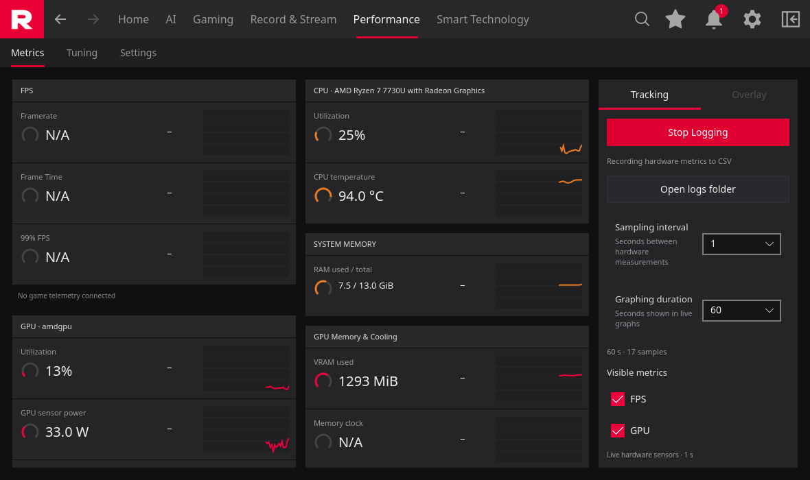
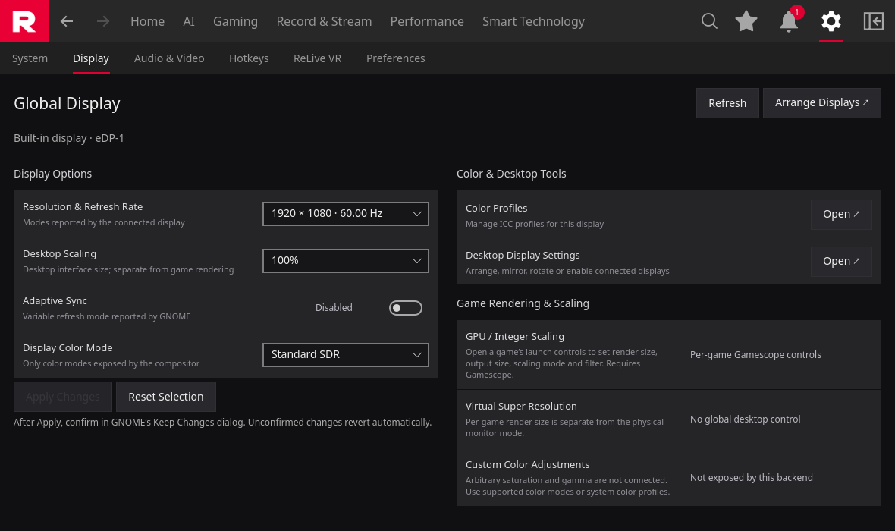
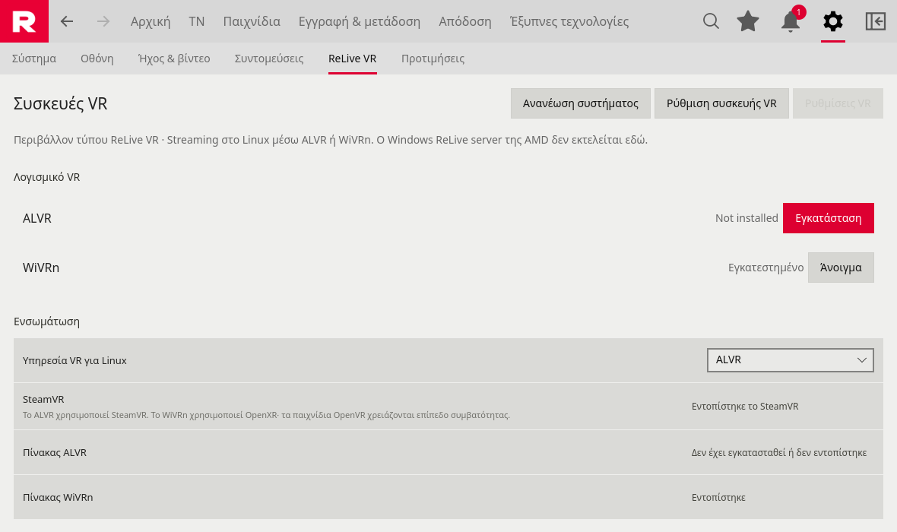

<p align="center"></p>
<h1 align="center">REDLINE · Linux Graphics Edition</h1>
<p align="center"><strong>Your hardware. Your games. One familiar control center.</strong><br>Developed by <a href="https://slave.gr">Slave IT Solutions — Greece</a></p>
<p align="center"><a href="#english">English</a> · <a href="#ελληνικά">Ελληνικά</a> · <a href="docs/PARITY-ROADMAP.md">Feature roadmap</a> · <a href="https://github.com/slaveitgr/Redline/issues">Report an issue</a></p>

---

## English

**Redline is an open-source, native Linux graphics and gaming control center with an Adrenalin-inspired interface.** It brings hardware monitoring, supported GPU tuning, game profiles and Linux gaming tools into a single Qt 6 application. Its goal is to make the move from Windows to Linux easier, especially for users who want clear controls instead of a collection of terminal commands.

Built and maintained in Greece by **Slave IT Solutions**, Redline combines a CoreCtrl-derived application foundation with an integrated LACT-derived GPU engine and a growing Redline interface.

> **Development preview:** active implementation is underway. Available controls depend on the GPU, Linux driver, desktop session and installed tools. A visible page does not imply that every Windows feature has a working Linux equivalent.

### Screenshots

Actual Redline interface from the development build.







### Inside Redline

| Area | Current implementation |
| --- | --- |
| **Home & navigation** | Dashboard, Steam library discovery, favorites, navigation history, search and session notifications. |
| **Performance metrics** | Live CPU/GPU/RAM monitoring, time-based charts, adjustable sampling and CSV logging. Unmeasured FPS stays unavailable. |
| **Hardware tuning** | Integrated GPU controls for capabilities exposed by the driver, confirmation/revert handling and CoreCtrl-derived CPU controls. |
| **Gaming tools** | GameMode, Gamescope and MangoHud detection, plus per-game Steam launch integration and overlay configuration. |
| **Local AI** | Ollama model discovery and session chat, with an optional hardware snapshot attached by the user. Requires a running local Ollama service and model. |
| **VR setup** | ALVR launcher installation and launch; WiVRn installation through an existing Flathub setup. Headset pairing and streaming are handled by the selected backend. |
| **System** | Hardware and driver information, driver compatibility catalog, settings export/import and scoped reset. |
| **Appearance** | Dark/light appearance, Greek/English core interface and Redline tray branding. |

Recording and streaming, advanced display controls and additional feature parity are under development. See the [coverage roadmap](docs/PARITY-ROADMAP.md), [display/capture status](docs/DISPLAY-CAPTURE-STATUS.md), [VR setup](docs/VR-INSTALLATION.md) and [AI integration](docs/AI-AND-HOME.md) for detailed scope. VR streaming has not yet been validated with a physical headset.

### Build and try

The current development target is **Ubuntu 26.10 amd64 with Qt 6.11.2**. Other distributions and older releases need separate validation.

The native application requires CMake, a C++20 compiler, Qt ≥ 6.8 (Core, DBus, Quick, Charts, Widgets, Network, Svg and Linguist tools), QuaZip for Qt 6, spdlog, pugixml, Botan and GLib/Polkit development libraries. Required QML modules include QtQuick, Controls, Layouts, Templates, Window, QtQml, Models, WorkerScript, Qt Charts and Qt Labs Platform.

```sh
git clone https://github.com/slaveitgr/Redline.git
cd Redline
./build-redline.sh
./build-gpu-engine.sh
./run-preview.sh
```

`run-preview.sh` lets you review the interface without applying hardware changes. The GPU engine uses the pinned Rust toolchain and native dependencies described in [its build notes](3rdparty/redline-gpu/README-REDLINE.md). Hardware control through `run-native.sh` requires the development helper setup. Run the graphical application as your regular user.

Debian packaging is being validated for the development target. Release artifacts and installation instructions will be announced here when ready; source availability should not be mistaken for a stable binary release.

### Designed for real Linux systems

Redline checks what the system actually exposes. Supported hardware controls use the integrated Linux backends; game overlays and launch options use the relevant gaming tools. Driver compatibility information is advisory, and Redline does not install a different graphics driver automatically.

Settings snapshots cover application preferences. They are not a backup of the operating system, GPU firmware or externally managed game files. See [snapshot scope and recovery](docs/SETTINGS-SNAPSHOTS.md).

### Help shape the project

[Open an issue](https://github.com/slaveitgr/Redline/issues) with your GPU, distribution, kernel, desktop session, Redline version and steps to reproduce the problem. Screenshots and relevant logs help; remove private information before posting. Reports from different AMD GPUs and desktop environments are especially useful.

Contributions to Linux backend support, accessibility, translations, interface consistency, packaging and testing are welcome. Keep capability checks and error messages accurate, and preserve upstream notices.

### Credits & licensing

- **Slave IT Solutions — Greece:** Redline development, product direction, interface and integration. [slave.gr](https://slave.gr) · [info@slave.gr](mailto:info@slave.gr).
- **CoreCtrl contributors:** application foundation, CPU controls and hardware-management infrastructure. [Upstream project](https://gitlab.com/corectrl/corectrl) · [retained upstream README](docs/UPSTREAM-README.md).
- **LACT contributors:** the foundation of the integrated GPU engine. [Upstream project](https://github.com/ilya-zlobintsev/LACT) · [integration notes](3rdparty/redline-gpu/README-REDLINE.md).
- **Qt, MangoHud, GameMode, Gamescope, ALVR, WiVRn and Ollama contributors:** the libraries and optional tools behind the wider Linux experience. These projects are maintained independently.

Redline and CoreCtrl-derived code are **GPL-3.0-or-later**; see [COPYING](COPYING) and [LICENSE](LICENSE). LACT-derived components retain their MIT license and component-specific notices. Included third-party licenses remain applicable when redistributing.

AMD Software: Adrenalin Edition is the interface reference. Redline is an independent community project; AMD and Radeon trademarks belong to their respective owners.

---

## Ελληνικά

**Το Redline είναι ένα ανοικτού κώδικα κέντρο ελέγχου γραφικών και gaming για Linux, με περιβάλλον εμπνευσμένο από το Adrenalin.** Συγκεντρώνει παρακολούθηση υλικού, υποστηριζόμενες ρυθμίσεις GPU, προφίλ παιχνιδιών και εργαλεία Linux gaming σε μία εφαρμογή Qt 6.

Αναπτύσσεται από τη **Slave IT Solutions στην Ελλάδα**, με στόχο η μετάβαση από τα Windows στο Linux να γίνει πιο εύκολη: οικείο περιβάλλον, κατανοητές επιλογές και λιγότερη ανάγκη για εντολές στο τερματικό.

### Τι προσφέρει σήμερα

- **Κεντρική σελίδα και βιβλιοθήκη Steam:** εντοπισμός εγκατεστημένων παιχνιδιών, αγαπημένα, αναζήτηση και ενιαία πλοήγηση.
- **Μετρήσεις απόδοσης:** ζωντανές ενδείξεις CPU/GPU/RAM, γραφήματα, επιλογή διαστήματος δειγματοληψίας και καταγραφή CSV.
- **Ρυθμίσεις υλικού:** ενσωματωμένος μηχανισμός GPU βασισμένος στο LACT και λειτουργίες CPU από το CoreCtrl, ανάλογα με την υποστήριξη του συστήματος.
- **Εργαλεία gaming:** έλεγχος διαθεσιμότητας GameMode, Gamescope και MangoHud, επιλογές εκκίνησης ανά παιχνίδι και ρυθμίσεις overlay.
- **Τοπικό AI:** σύνδεση με το Ollama για επιλογή μοντέλου και συνομιλία. Προαιρετική προσθήκη μετρήσεων υλικού στο μήνυμα.
- **Προετοιμασία VR:** εγκατάσταση και άνοιγμα του ALVR launcher, καθώς και εγκατάσταση WiVRn μέσω υπάρχοντος Flathub. Ο χρήστης επιλέγει το backend που ταιριάζει στο headset του.
- **Εξατομίκευση:** σκοτεινή/φωτεινή εμφάνιση, ελληνικά/αγγλικά στον βασικό κορμό του περιβάλλοντος και εικονίδιο Redline στο tray.
- **Ρυθμίσεις και πληροφορίες:** στοιχεία συστήματος, πληροφορίες συμβατότητας οδηγών και εξαγωγή/εισαγωγή προτιμήσεων.

### Κατάσταση ανάπτυξης

Το Redline βρίσκεται σε **έκδοση ανάπτυξης**. Οι λειτουργίες recording/streaming, οι προηγμένες ρυθμίσεις οθόνης και η περαιτέρω αντιστοίχιση λειτουργιών εξελίσσονται. Η διαθεσιμότητα εξαρτάται από την κάρτα γραφικών, τον οδηγό, το γραφικό περιβάλλον και τα εγκατεστημένα εργαλεία. Δεν έχει ακόμη ολοκληρωθεί δοκιμή VR με πραγματικό headset.

Ο τρέχων στόχος ανάπτυξης είναι **Ubuntu 26.10 amd64 / Qt 6.11.2**. Για δοκιμή από τον πηγαίο κώδικα, ακολούθησε τις παραπάνω οδηγίες και ξεκίνησε με το `run-preview.sh`, το οποίο δεν εφαρμόζει αλλαγές στο υλικό. Τα πακέτα Debian βρίσκονται σε διαδικασία ελέγχου.

Δες τον [αναλυτικό χάρτη λειτουργιών](docs/PARITY-ROADMAP.md). Για προβλήματα ή προτάσεις, χρησιμοποίησε τα [GitHub Issues](https://github.com/slaveitgr/Redline/issues), αναφέροντας διανομή, GPU, kernel και βήματα αναπαραγωγής.

### Δημιουργία & συντελεστές

**Slave IT Solutions — Greece** · [slave.gr](https://slave.gr) · [info@slave.gr](mailto:info@slave.gr)

Ευχαριστούμε τους συντελεστές των **CoreCtrl** και **LACT**, πάνω στη δουλειά των οποίων βασίζονται σημαντικά τμήματα του Redline, καθώς και τις κοινότητες **Qt, MangoHud, GameMode, Gamescope, ALVR, WiVRn και Ollama**. Οι άδειες και οι αναφορές των επιμέρους έργων διατηρούνται στον πηγαίο κώδικα.

Το Redline διατίθεται με **GPL-3.0-or-later**, με τις επιμέρους άδειες των ενσωματωμένων βιβλιοθηκών. Είναι ανεξάρτητο κοινοτικό έργο.
